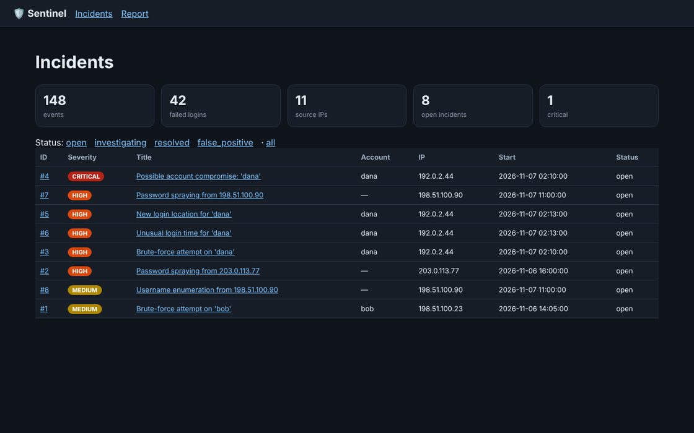

# 🛡️ Sentinel — personal security monitoring platform

Sentinel reads login logs, finds attack patterns, stores incidents in SQLite, and produces reports and a web dashboard for reviewing alerts.



## My role & contributions

**Solo developer · AI-assisted**

- Chose the project and the six attack patterns to detect, and set the detection thresholds and severity levels
- Designed the SQLite schema that links each incident to its evidence
- Ran the detector against generated attack logs and checked it found all 4 attacks with zero false alarms on clean traffic
- Wrote the README, detection-logic notes, and roadmap

**Languages:** Python · SQL (SQLite) · HTML/CSS
**Shows:** practical cybersecurity detection logic, log parsing, database design, testing.

## Quick start
```bash
python -m sentinel demo            # generate logs → ingest → detect → report.html/report.md in demo_output/
pip install flask                  # optional
python -m sentinel --db demo_output/sentinel.db serve    # dashboard on http://127.0.0.1:8050
python -m pytest -q                # 13 tests
```
Requires Python 3.10+. The core uses only the standard library. Flask is needed only for the dashboard.

## Use it on real logs
```bash
sudo cp /var/log/auth.log ./auth.log        # or /var/log/secure on RHEL/Fedora
python -m sentinel ingest auth.log --year 2026
python -m sentinel detect --allow 10.0.0.5  # ignore a trusted IP
python -m sentinel incidents
python -m sentinel update 3 --status investigating --note "Asked dana about 2am login"
python -m sentinel report weekly.html
```
Supported inputs: OpenSSH lines from `auth.log`/`secure` (classic or ISO timestamps), JSON Lines, and CSV with `timestamp,user,ip,success` columns. Re-ingesting the same file is safe because duplicates are ignored.

## Detection rules
| Rule | What it catches | Default threshold | Severity | MITRE ATT&CK |
|---|---|---|---|---|
| `brute_force` | Many failures for one account from one IP | 5 in 5 min | medium (high if it led to a login) | T1110.001 |
| `password_spray` | One IP failing against many accounts | 4 accounts in 10 min | high | T1110.003 |
| `success_after_failures` | A successful login right after repeated failures | 3 failures in 10 min | **critical** | T1078 |
| `user_enumeration` | Attempts on non-existent usernames | 5 in 10 min | medium | T1087 |
| `new_ip_for_user` | Login from an IP the user has never used | after 5 baseline logins | low (high if correlated) | T1078 |
| `off_hours_login` | 00:00–05:00 login for a daytime-only user | after 5 baseline logins | low (high if correlated) | T1078 |

A correlation step escalates related findings. For example, a new-IP login that is also a likely compromise becomes high severity. Repeated attempts in one burst produce one incident, not dozens. Re-running detection updates incidents instead of duplicating them. See `docs/DETECTION_RULES.md` for the logic and the tuning trade-offs.

## Architecture
```
logs ──► parsers.py ──► events (SQLite) ──► detectors.py ──► incidents (SQLite) ──► report.py (MD/HTML)
                                                                     └──────────► web.py (Flask dashboard)
```
- `db.py` — schema with `events`, `incidents`, and an `incident_events` evidence link table; indexes on (ip, ts) and (user, ts); idempotent inserts.
- `generator.py` — synthetic logs with labeled attacks, using RFC 5737 documentation IPs only.
- Dashboard: filters, incident detail with every evidence event, status workflow (open → investigating → resolved / false_positive), and investigation notes. All output is HTML-escaped, and pages send CSP headers.

## Results on the bundled synthetic data
All 4 injected attacks were detected (brute force, spraying, compromise, enumeration). The compromise also raised correlated new-IP and off-hours alerts. **Zero alerts** on the same week of traffic with the attacks removed. See `TEST_RESULTS.md`.

## Limits
Heuristic rules, not machine learning. Thresholds trade missed attacks against false alarms. There's no GeoIP. Synthetic data is cleaner than real logs. See `ROADMAP.md`.

## License

**Permission required.** © 2026 Dagmawi Melaku. You need my written permission before using, copying, or modifying this code, and any approved use must credit me with a link to this repository. Viewing, forking on GitHub, and running it to judge or review a submission are allowed without asking. To ask, [open an issue](../../issues/new). See [LICENSE](LICENSE) for the full terms.
